# QUIZVERSE Entity-Relationship (ER) Architecture

This document presents the complete Entity-Relationship diagram for the **QUIZVERSE** PostgreSQL database architecture, covering all 34 relational entities across 13 functional modules.

```mermaid
erDiagram
    %% ==========================================
    %% 1. RBAC & ADMINISTRATION
    %% ==========================================
    admins ||--o{ admin_roles : "assigned"
    roles ||--o{ admin_roles : "grants"
    roles ||--o{ role_permissions : "contains"
    permissions ||--o{ role_permissions : "defines"
    admins ||--o{ audit_logs : "performs"
    admins ||--o{ questions : "authors"
    admins ||--o{ quizzes : "creates"
    admins ||--o{ invitation_links : "issues"

    admins {
        uuid id PK
        uuid auth_user_id UK "Supabase Auth UID"
        varchar full_name
        varchar email UK
        varchar status "active | suspended"
        timestamptz created_at
        timestamptz updated_at
    }

    roles {
        uuid id PK
        varchar role_name UK
        text description
        timestamptz created_at
        timestamptz updated_at
    }

    permissions {
        uuid id PK
        varchar permission_name UK
        text description
        timestamptz created_at
    }

    admin_roles {
        uuid admin_id PK,FK
        uuid role_id PK,FK
        timestamptz created_at
    }

    role_permissions {
        uuid role_id PK,FK
        uuid permission_id PK,FK
        timestamptz created_at
    }

    %% ==========================================
    %% 2. ACADEMIC STRUCTURE
    %% ==========================================
    units ||--o{ chapters : "contains"
    chapters ||--o{ topics : "contains"
    topics ||--o{ questions : "categorizes"

    units {
        uuid id PK
        varchar unit_name
        varchar unit_code UK
        text description
        int display_order
        varchar status
        timestamptz created_at
        timestamptz updated_at
    }

    chapters {
        uuid id PK
        uuid unit_id FK
        varchar chapter_name
        varchar chapter_code
        text description
        int display_order
        varchar status
        timestamptz created_at
        timestamptz updated_at
    }

    topics {
        uuid id PK
        uuid chapter_id FK
        varchar topic_name
        text description
        int display_order
        varchar status
        timestamptz created_at
        timestamptz updated_at
    }

    %% ==========================================
    %% 3. QUESTION BANK
    %% ==========================================
    questions ||--o{ question_options : "has"
    questions ||--o{ question_tag_relations : "tagged"
    question_tags ||--o{ question_tag_relations : "labels"
    questions ||--o{ question_versions : "versions"
    questions ||--o{ quiz_questions : "included_in"

    questions {
        uuid id PK
        uuid topic_id FK
        text question_text
        varchar question_type "single_choice | multiple_choice | etc"
        varchar difficulty "easy | medium | hard"
        numeric default_marks
        numeric default_negative_marks
        text explanation
        varchar question_image_path
        varchar status "draft | published | archived"
        uuid created_by FK
        timestamptz created_at
        timestamptz updated_at
    }

    question_options {
        uuid id PK
        uuid question_id FK
        text option_text
        varchar option_image_path
        int option_order
        boolean is_correct
        timestamptz created_at
        timestamptz updated_at
    }

    question_tags {
        uuid id PK
        varchar tag_name UK
        timestamptz created_at
    }

    question_tag_relations {
        uuid question_id PK,FK
        uuid tag_id PK,FK
        timestamptz created_at
    }

    question_versions {
        uuid id PK
        uuid question_id FK
        int version_number
        jsonb question_snapshot
        uuid changed_by FK
        timestamptz created_at
    }

    %% ==========================================
    %% 4. QUIZ ARCHITECTURE
    %% ==========================================
    quizzes ||--o{ quiz_questions : "comprises"
    quizzes ||--o{ quiz_generation_rules : "automated_by"
    quizzes ||--o{ generation_history : "logs_generation"
    quizzes ||--o{ registration_form_fields : "configures_form"
    quizzes ||--o{ registration_submissions : "receives_submissions"
    quizzes ||--o{ invitation_links : "access_via"
    quizzes ||--o{ examination_attempts : "attempted_by"
    quizzes ||--o{ analytics_snapshots : "evaluated_in"

    quizzes {
        uuid id PK
        varchar title
        varchar slug UK
        text description
        text instructions
        int duration_minutes
        numeric total_marks
        numeric passing_percentage
        int max_attempts
        boolean shuffle_questions
        boolean shuffle_options
        boolean show_results_immediately
        boolean show_correct_answers
        boolean allow_review
        varchar status "draft | scheduled | published | archived"
        timestamptz start_time
        timestamptz end_time
        uuid created_by FK
        timestamptz created_at
        timestamptz updated_at
    }

    quiz_questions {
        uuid id PK
        uuid quiz_id FK
        uuid question_id FK
        int question_order
        numeric marks
        numeric negative_marks
        jsonb question_snapshot "Immutable freeze"
        timestamptz created_at
    }

    quiz_generation_rules {
        uuid id PK
        uuid quiz_id FK
        varchar rule_name
        jsonb target_topic_ids
        numeric easy_percentage
        numeric medium_percentage
        numeric hard_percentage
        int total_questions_target
        timestamptz created_at
        timestamptz updated_at
    }

    generation_history {
        uuid id PK
        uuid rule_id FK
        uuid quiz_id FK
        uuid generated_by FK
        int questions_selected_count
        jsonb generation_rule_snapshot
        varchar status
        text notes
        timestamptz created_at
    }

    %% ==========================================
    %% 5. STUDENTS & CUSTOM REGISTRATION
    %% ==========================================
    students ||--|| student_profiles : "profile"
    students ||--o{ registration_submissions : "submits"
    students ||--o{ invitation_usage : "redeems"
    students ||--o{ examination_attempts : "sits"
    students ||--o{ examination_results : "achieves"
    students ||--o{ security_events : "triggers"

    students {
        uuid id PK
        uuid auth_user_id UK "Supabase Auth UID or NULL"
        varchar full_name
        varchar email UK
        varchar phone
        boolean is_guest
        varchar status "active | suspended"
        timestamptz created_at
        timestamptz updated_at
    }

    student_profiles {
        uuid id PK
        uuid student_id FK,UK
        varchar avatar_url
        varchar institution
        varchar student_identifier
        text bio
        varchar timezone
        timestamptz created_at
        timestamptz updated_at
    }

    registration_form_fields {
        uuid id PK
        uuid quiz_id FK
        varchar field_label
        varchar field_name
        varchar field_type
        boolean is_required
        int display_order
        jsonb validation_rules
        timestamptz created_at
    }

    registration_submissions {
        uuid id PK
        uuid quiz_id FK
        uuid student_id FK
        jsonb submitted_data
        timestamptz created_at
    }

    %% ==========================================
    %% 6. INVITATION & ACCESS
    %% ==========================================
    invitation_links ||--o{ invitation_usage : "tracked_usage"

    invitation_links {
        uuid id PK
        uuid quiz_id FK
        varchar token_hash UK "SHA-256 Hash"
        varchar target_email
        int max_uses
        int used_count
        timestamptz expires_at
        boolean is_revoked
        uuid created_by FK
        timestamptz created_at
        timestamptz updated_at
    }

    invitation_usage {
        uuid id PK
        uuid invitation_id FK
        uuid student_id FK
        varchar ip_address
        text user_agent
        timestamptz used_at
    }

    %% ==========================================
    %% 7. EXAMINATION EXECUTION & EVALUATION
    %% ==========================================
    examination_attempts ||--o{ attempt_answers : "records"
    examination_attempts ||--o{ attempt_events : "monitors"
    examination_attempts ||--|| examination_results : "yields"
    examination_results ||--o{ question_evaluations : "details"

    examination_attempts {
        uuid id PK
        uuid quiz_id FK
        uuid student_id FK
        int attempt_number
        varchar status "in_progress | submitted | timed_out"
        timestamptz started_at
        timestamptz expires_at "Hard deadline"
        timestamptz submitted_at
        int time_spent_seconds
        varchar ip_address
        text user_agent
        timestamptz created_at
        timestamptz updated_at
    }

    attempt_answers {
        uuid id PK
        uuid attempt_id FK
        uuid quiz_question_id FK
        jsonb selected_option_ids
        text text_response
        int time_spent_seconds
        boolean is_flagged_for_review
        timestamptz answered_at
    }

    attempt_events {
        uuid id PK
        uuid attempt_id FK
        varchar event_type "tab_switch | window_blur | fullscreen_exit"
        jsonb event_metadata
        timestamptz occurred_at
    }

    examination_results {
        uuid id PK
        uuid attempt_id FK,UK
        uuid quiz_id FK
        uuid student_id FK
        numeric score
        numeric percentage
        boolean is_passed
        int total_correct
        int total_incorrect
        int total_unanswered
        int rank
        numeric percentile
        timestamptz calculated_at
    }

    question_evaluations {
        uuid id PK
        uuid result_id FK
        uuid quiz_question_id FK
        boolean is_correct
        boolean is_partially_correct
        numeric marks_awarded
        text feedback
        timestamptz created_at
    }

    %% ==========================================
    %% 8. ANALYTICS, SECURITY & NOTIFICATIONS
    %% ==========================================
    analytics_snapshots {
        uuid id PK
        uuid quiz_id FK
        int total_participants
        numeric average_score
        numeric highest_score
        numeric lowest_score
        numeric median_score
        int pass_count
        int fail_count
        jsonb topic_performances
        jsonb question_breakdowns
        timestamptz snapshot_at
    }

    audit_logs {
        uuid id PK
        uuid admin_id FK
        varchar action
        varchar entity_type
        varchar entity_id
        jsonb details
        varchar ip_address
        timestamptz created_at
    }

    security_events {
        uuid id PK
        uuid student_id FK
        uuid attempt_id FK
        varchar severity "info | warning | critical"
        varchar event_name
        text description
        varchar ip_address
        text user_agent
        timestamptz created_at
    }

    access_logs {
        uuid id PK
        uuid user_id
        varchar user_type "admin | student | guest"
        varchar endpoint
        varchar method
        int status_code
        int response_time_ms
        varchar ip_address
        timestamptz created_at
    }

    notifications {
        uuid id PK
        varchar recipient_type "student | admin"
        uuid recipient_id
        varchar title
        text message
        varchar notification_type
        boolean is_read
        timestamptz read_at
        jsonb metadata_json
        timestamptz created_at
    }

    notification_preferences {
        uuid id PK
        varchar recipient_type
        uuid recipient_id
        boolean email_notifications
        boolean in_app_notifications
        boolean security_alerts
        timestamptz created_at
        timestamptz updated_at
    }
```

