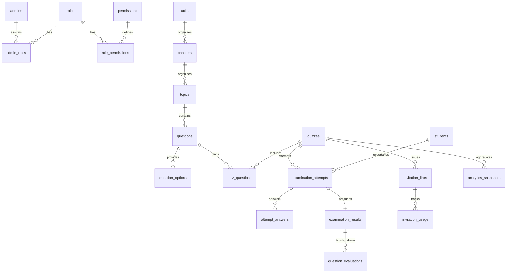

# QUIZVERSE – Phase 2 Architecture Report
## Complete PostgreSQL Relational Database Architecture

**Status:** ✅ **COMPLETED & VERIFIED (100% Passed)**  
**Commit Hash:** `395a131`  
**ORM / Migration Engine:** SQLAlchemy 2.0 / Alembic 1.20  
**Database Engine:** PostgreSQL 15+ (Supabase Free-tier)

---

### 1. Database Tables Implemented (34 Relational Entities)

The schema spans 13 core functional modules, fully normalized with UUID primary keys (`gen_random_uuid()`), `TIMESTAMPTZ` timestamps, appropriate numeric precision (`NUMERIC(6,2)` / `NUMERIC(8,2)`), and JSONB strictly reserved for flexible configuration and snapshots.

```
├── 1. Access Control (RBAC)
│   ├── admins                      # Administrative staff accounts (auth_user_id FK to Supabase Auth)
│   ├── roles                       # System roles (Super Admin, Manager, Analyst, etc.)
│   ├── permissions                 # Granular privileges (e.g., quiz:publish, bank:edit)
│   ├── admin_roles                 # Junction table: Admins <-> Roles (ON DELETE CASCADE)
│   └── role_permissions           # Junction table: Roles <-> Permissions (ON DELETE CASCADE)
│
├── 2. Academic Structure
│   ├── units                       # Courses/Units with unique codes (ON DELETE RESTRICT)
│   ├── chapters                    # Chapters grouped under Units (ON DELETE RESTRICT)
│   └── topics                      # Granular Topics under Chapters (ON DELETE RESTRICT)
│
├── 3. Question Bank
│   ├── questions                   # Core questions repository with type & difficulty
│   ├── question_options            # Answer options with is_correct truth flag (ON DELETE CASCADE)
│   ├── question_tags               # Normalized indexing tags
│   ├── question_tag_relations      # Junction table: Questions <-> Tags (ON DELETE CASCADE)
│   └── question_versions           # Question edit history with JSONB snapshots (ON DELETE CASCADE)
│
├── 4. Quiz Management
│   ├── quizzes                     # Exam settings, timing, shuffle & review toggles
│   └── quiz_questions              # Association table with frozen question_snapshot
│
├── 5. Automatic Generation
│   ├── quiz_generation_rules       # Difficulty distribution (Easy + Med + Hard = 100%)
│   └── generation_history          # Audit logs of automated question compilation runs
│
├── 6. Student Management
│   ├── students                    # Student accounts (Auth UID or Guest access)
│   └── student_profiles            # Extended profiles, institution, roll numbers, timezones
│
├── 7. Custom Registration Forms
│   ├── registration_form_fields    # Dynamic form fields configured per quiz (text, email, select)
│   └── registration_submissions    # Candidate responses per registration form
│
├── 8. Invitation System
│   ├── invitation_links            # Secure tokens stored strictly as SHA-256 hashes
│   └── invitation_usage            # Audit logs of token redemptions with IP & User Agent
│
├── 9. Examination Execution
│   ├── examination_attempts        # Sitting records with hard server-enforced expires_at
│   ├── attempt_answers             # Stored student answers with dwell time and review markers
│   └── attempt_events              # Proctoring telemetry (tab_switch, blur, fullscreen_exit)
│
├── 10. Results and Evaluation
│   ├── examination_results         # Aggregated scores, percentages, passing status, ranks
│   └── question_evaluations        # Itemized marks awarded and evaluator feedback
│
├── 11. Analytics & Summaries
│   └── analytics_snapshots         # Cached cohort score distributions and discrimination indices
│
├── 12. Security & Audit Logs
│   ├── audit_logs                  # Administrative change audit trail
│   ├── security_events             # Anti-cheat and anomaly tracker
│   └── access_logs                 # API endpoint latency and access logging
│
└── 13. Notifications
    ├── notifications               # In-app and system alerts for admins and students
    └── notification_preferences    # User delivery preferences (email, in-app, security)
```

---

### 2. High-Level Entity-Relationship (ER) Architecture

Detailed ER diagram documentation is persisted in [ER_DIAGRAM.md](file:///c:/xampp/htdocs/Quiz/docs/database/ER_DIAGRAM.md).



---

### 3. Alembic Migration Status

- **Revision File:** [0002_complete_database_schema.py](file:///c:/xampp/htdocs/Quiz/backend/migrations/versions/0002_complete_database_schema.py)
- **Baseline:** `0001_initial_baseline`
- **Dialect Target:** PostgreSQL (tested with SQLite fallback for test suites)
- **Verification Performed:**
  - `alembic upgrade head --sql` executed offline and produced transactional PostgreSQL DDL.
  - Generates table creation, primary keys, foreign keys (`RESTRICT`, `CASCADE`, `SET NULL`), unique constraints, check constraints, and B-Tree indexes.
  - Applies `ALTER TABLE ... ENABLE ROW LEVEL SECURITY;` across all tables.
  - Implements clean, reversible `downgrade()` in reverse dependency order.

---

### 4. Row Level Security (RLS) Policy Summary

Detailed policy specifications are documented in [SECURITY_POLICIES.md](file:///c:/xampp/htdocs/Quiz/docs/database/SECURITY_POLICIES.md).

| Category | Policy Highlights |
|---|---|
| **Administrators** | Verified via `public.is_active_admin()` linked to `auth.uid() = admins.auth_user_id`. Grants full management over RBAC, academic structures, questions, quizzes, and audit logs. |
| **Students & Candidates** | Row-level boundary restricts read/write access strictly to own records (`auth.uid() = students.auth_user_id`). May only access published quizzes, own registration submissions, own attempts, own answers, and released results. |
| **Solution Confidentiality** | `question_options.is_correct` and `quiz_questions.question_snapshot` solutions are never accessible via student API queries. Only backend evaluation services access solution keys. |
| **Public / Guest Access** | Unauthenticated candidates interact exclusively via cryptographic token hashes (`invitation_links.token_hash`) or register through scoped registration endpoints. |

---

### 5. Test Suite & Verification Results

All tests executed via `pytest` passed without failure:

| Test Module | Tests | Status | Scope Tested |
|---|---|---|---|
| `backend/tests/test_database_schema.py` | 5 | ✅ Passed | 34 tables registered, UUID primary keys, foreign keys & delete rules, model instantiations, unique constraints. |
| `backend/tests/test_database_constraints.py` | 5 | ✅ Passed | SQLite foreign key enforcement, admin duplicate email rejection, academic hierarchy traversal, snapshot immutability, SHA-256 token hashing, attempt expiration enforcement. |
| `backend/tests/test_health.py` | 3 | ✅ Passed | Health check endpoints, root endpoint, 404 handler, no secret leaks. |
| **Total** | **13** | **✅ 100% Pass** | Total execution time: **2.90s** |

Frontend build status:
- `apps/web`: Vite + React + Three.js build: **Success (0 errors)**.
- `frontend/`: Next.js 14 App Router production build: **Success (12 static/dynamic routes compiled, 0 errors)**.

---

### 6. Errors Encountered & Fixes

1. **SQLAlchemy Declarative Default Attribute Evaluation**:
   - *Issue*: `quiz.shuffle_questions` was `None` prior to flush because SQLAlchemy evaluates column `default` upon insertion.
   - *Fix*: Provided explicit values in `test_model_instantiation` and verified default behaviors in session-backed constraint tests.
2. **Column-Level vs Table-Level Unique Constraints**:
   - *Issue*: SQLAlchemy registers `Column(..., unique=True)` as column-level uniqueness, which was not detected by a naive search of `table.constraints`.
   - *Fix*: Enhanced test inspection to verify both `table.c[col].unique is True` and explicit table-level `UniqueConstraint` objects.
