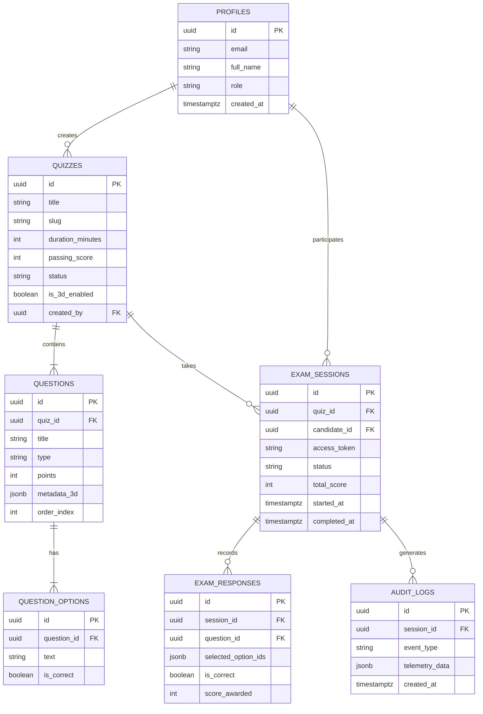

# QUIZVERSE Relational Database Blueprint (Phase 3 Preparation)

## 1. Engine & Hosting
- **Engine**: PostgreSQL 15+ hosted on Supabase Cloud Free Tier.
- **Access Strategy**:
  - Web client connects via public anon key subject to Row Level Security (RLS).
  - Backend API connects via service-role key for administrative tasks and grading audits.

---

## 2. Entity-Relationship Schema Outline

---

## 3. Row Level Security (RLS) Strategy

All tables in Phase 3 will have Row Level Security explicitly enabled (`ALTER TABLE ... ENABLE ROW LEVEL SECURITY`).

| Table | SELECT Policy | INSERT/UPDATE Policy |
| :--- | :--- | :--- |
| `profiles` | Users can view own profile; Admins view all | Users can update own profile name/avatar |
| `quizzes` | Published quizzes visible to all; Drafts visible to creator/admin | Creators & Admins only |
| `questions` | Hidden during active exam; Admins view all | Creators & Admins only |
| `question_options` | Correct answer flag stripped for student queries | Creators & Admins only |
| `exam_sessions` | Candidates can only view their own session | Inserted upon valid token submission |
| `audit_logs` | Invisible to candidate; Admins view all | Insertable by active candidate session |

---

## 4. Realtime & Storage Preparation
- **Realtime Channels**:
  - `quiz-session:<id>`: Broadcasts candidate heartbeats, proctor announcements, and time sync updates.
- **Storage Buckets**:
  - `exam-assets`: Public read access for 3D GLTF models, texture maps, and question illustration media.
